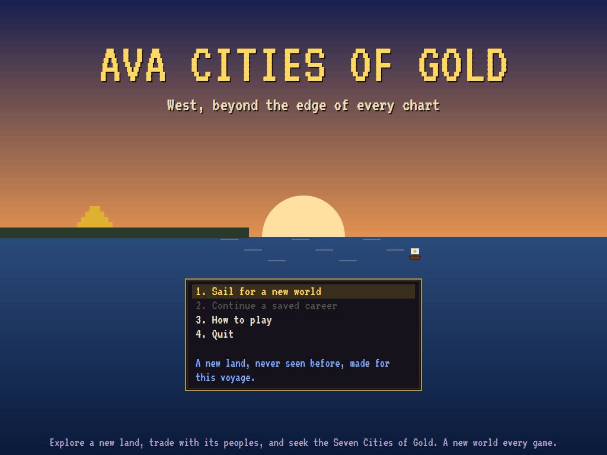
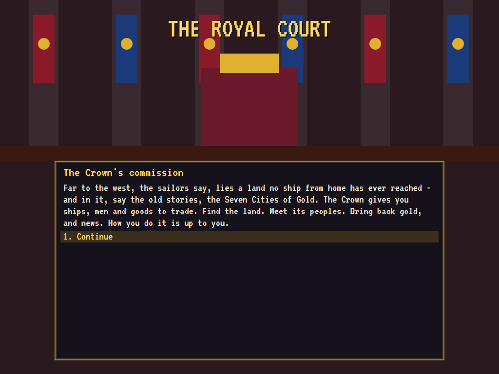
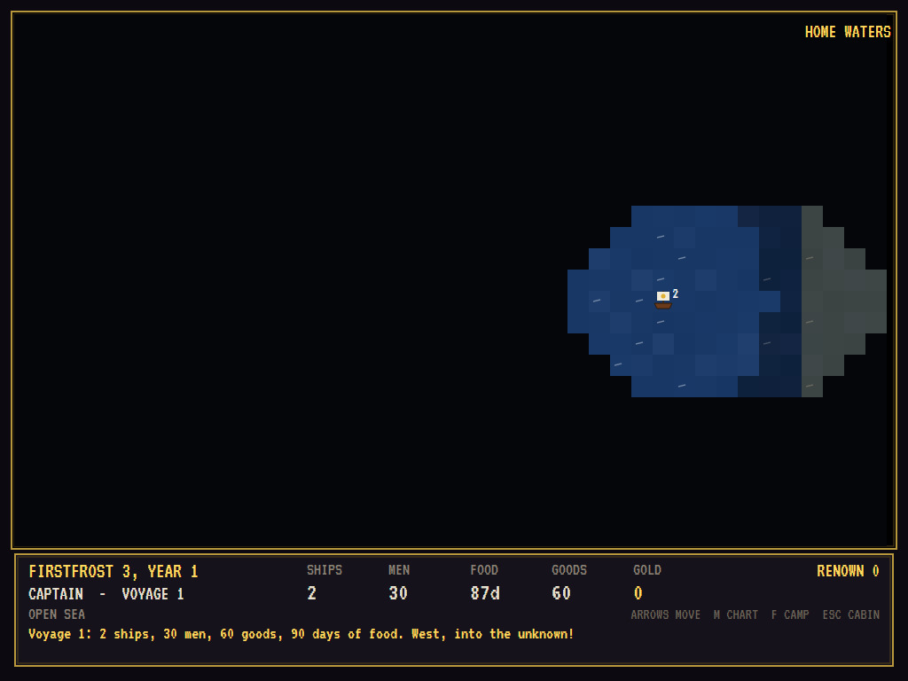
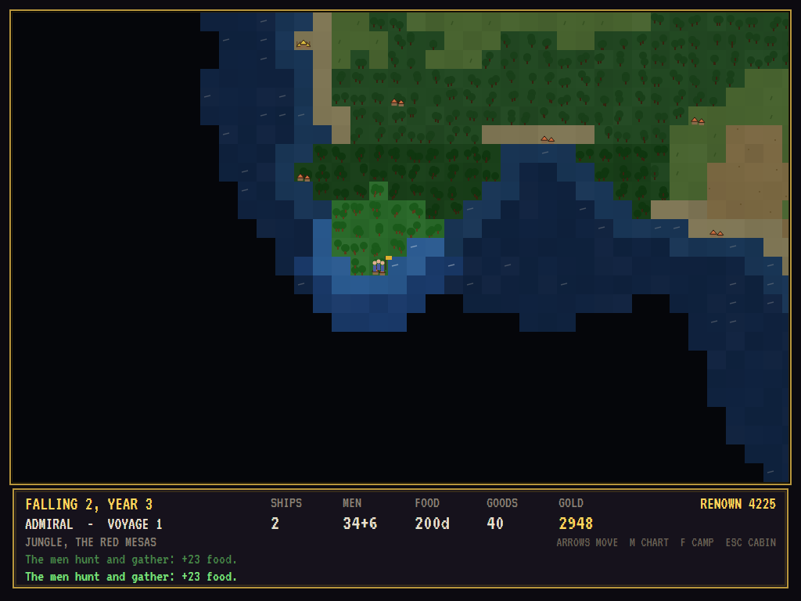
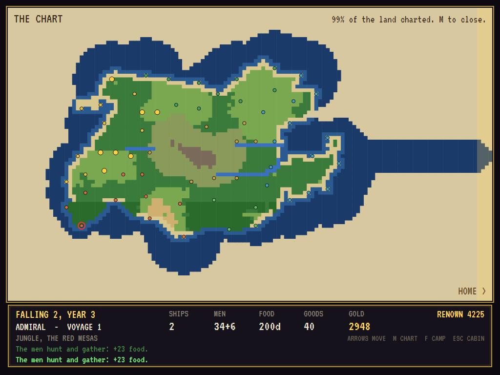
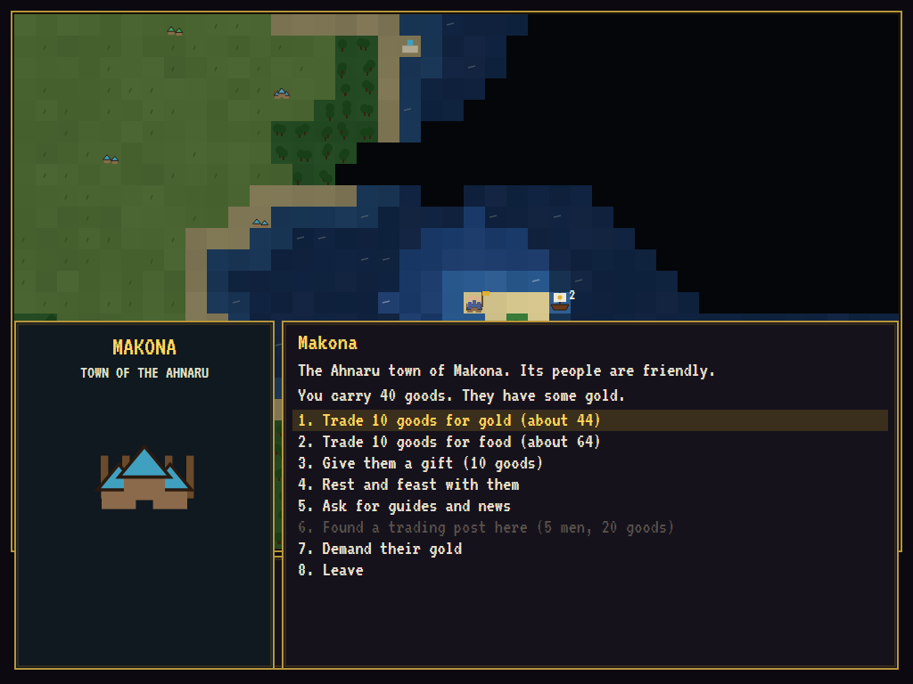
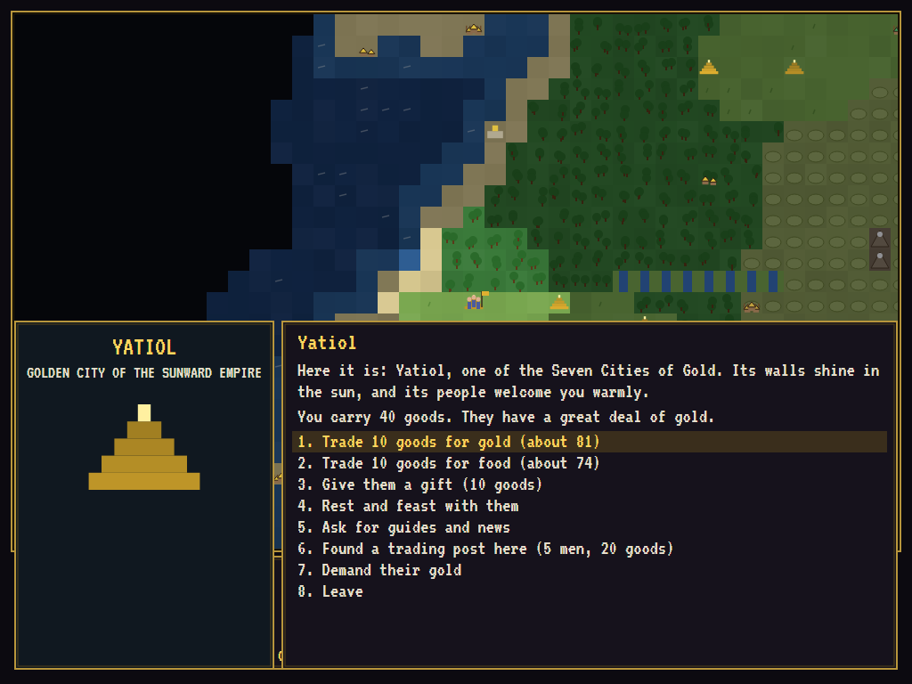
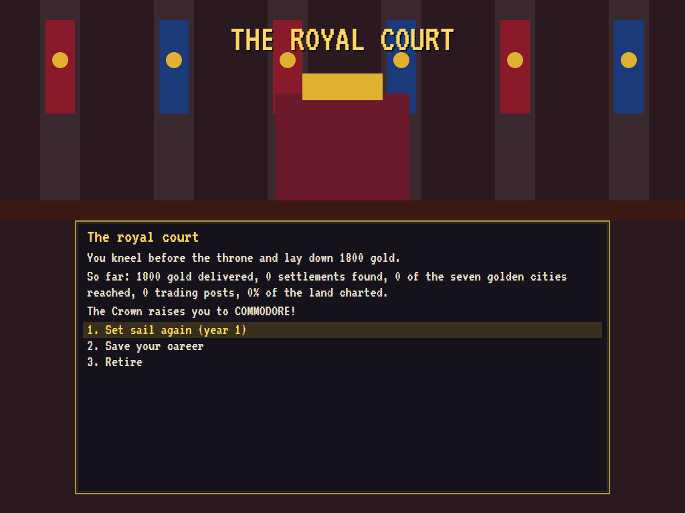
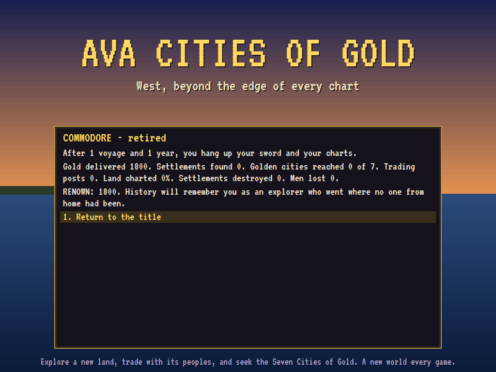

# AVACitiesOfGold

[](https://github.com/Harlock123/AVACitiesOfGold/actions/workflows/build.yml)

An exploration and trading game in the spirit of Ozark Softscape's 1984 classic **Seven Cities of
Gold**, built with .NET 10 and Avalonia UI. The Crown gives you ships, men and trade goods and sends
you west, to a land no one from home has ever reached. Chart its coasts and rivers, meet its peoples,
trade, make friends or enemies, and look for the seven cities of gold the old stories tell of. Then
sail home, lay your gold before the throne, and rise from Captain to Viceroy over a twenty-year career.

Every game makes a new continent, with its own peoples, settlements and golden cities. The land,
peoples, names and wording are original: this is the *style* of the classic, not its contents.

## A career

1. **The commission**: the Crown outfits your voyage by rank. A Captain gets two ships, 30 men and 60
   goods; a Viceroy, five ships, 90 men and 220 goods. Everyone gets 90 days of food.
2. **The crossing**: sail west from home waters across open sea. Each day at sea eats food, and storms
   can cost you men or ships.
3. **Ashore**: sail into land to put your men ashore. Three men per ship stay aboard as keepers. On
   land:
   - **Travel**: every kind of ground has its own pace. Grass and beach are quick; forest, jungle and
     hills are slow; mountains are slower still.
   - **Food**: everyone eats every day. **F** camps for a day to hunt and forage.
   - **Dangers**: falls, fever and ambushes. There are also old ruins to find.
4. **Meeting people**: walk into a settlement. Depending on how its people feel about you, you can:
   - **Trade**: ten goods buys gold or food.
   - **Make friends**: give gifts and feast together.
   - **Ask for guides**: they'll tell you which way the cities of gold lie.
   - **Found a trading post**: friends only. It costs five men and twenty goods, and sends gold home
     every voyage after.
   - **Demand their gold**: force wins it, but every people in the land hears of it.
5. **Home**: sail back into home waters and kneel before the throne. Your gold and your trading posts
   earn renown, and renown earns promotion: Captain, Commodore, Admiral, Governor, Viceroy.

After twenty years the Crown retires you, or you may retire sooner. History then judges your career
by your renown: gold delivered, settlements found, golden cities reached, trading posts founded and
land charted, less any settlements you destroyed.

## Features

- **A new world every game**:
  - **The land**: a 128 × 80 continent with coasts, beaches, rivers, forests, jungle, grassland,
    desert, hills and snow-capped mountains.
  - **The peoples**: each new continent is shared among six peoples, each with a homeland, a temper
    and a way of naming its towns:
    - the **Ahnaru** of the Dawn Coast
    - the **Tecolo** of the Cedar Lands
    - the **Ruuma** of the Long Grass
    - the **Ilvani** of the Green Deep
    - the **Kesh** of the Red Mesas
    - the **Sunward Empire** in the heights, where the seven golden cities are hidden
- **Peoples who remember**:
  - **Each settlement**: it keeps its own regard for you.
  - **Each people**: it has its own attitude. Kindness to one village warms its whole people; force
    anywhere cools every people in the land.
  - **Hostility**: a hostile people greets you with war drums.
- **Fog of war**: the land is dark until you see it. **M** shows the chart of everything you've seen.
- **Saved careers**: five save slots, kept in your user settings folder.
- **Sound**: a tune on the title, the surf and the forest, drums, trade, storms and a royal
  fanfare, all mixed by OpenAL.
- **Attract mode**: leave the title alone for 30 seconds and an explorer sets sail by themselves.
- **Any window size**: the screen scales to fit. **Ctrl+S** saves a screenshot.
- **One self-contained executable** per platform: Windows, macOS and Linux on Intel/AMD and ARM.

## Screenshots

| The title | The commission | The crossing |
|:---------:|:--------------:|:------------:|
|  |  |  |
| West, beyond the edge of every chart. | The Crown sends you west. | Leaving home waters. |

| Ashore | The chart | A town |
|:------:|:---------:|:------:|
|  |  |  |
| Foraging in the jungle. | A continent charted. | Meeting the Ahnaru. |

| A city of gold | The royal court | Retired |
|:--------------:|:---------------:|:-------:|
|  |  |  |
| One of the seven. | Gold for the Crown, and a promotion. | History's verdict. |

The tests make these screenshots by playing the game in a real (headless) window; see
[Tests](#tests).

## Download and run

The [Releases page](https://github.com/Harlock123/AVACitiesOfGold/releases/tag/latest) has
ready-to-run builds for Windows, macOS and Linux, on both Intel/AMD and ARM. **Latest build** is
rebuilt on every push to `main`. Each download is one self-contained executable, so there's no .NET to
install.

| Platform | Archive |
|---|---|
| Windows | `AVACitiesOfGold-win-x64.zip`, `AVACitiesOfGold-win-x86.zip`, `AVACitiesOfGold-win-arm64.zip` |
| macOS | `AVACitiesOfGold-osx-arm64.tar.gz` (Apple silicon), `AVACitiesOfGold-osx-x64.tar.gz` (Intel) |
| Linux | `AVACitiesOfGold-linux-x64.tar.gz`, `AVACitiesOfGold-linux-arm64.tar.gz`, `AVACitiesOfGold-linux-arm.tar.gz` |

```bash
tar -xzf AVACitiesOfGold-linux-x64.tar.gz     # or linux-arm64, linux-arm, osx-arm64, osx-x64
./AVACitiesOfGold
```

On Windows, unzip the archive and run `AVACitiesOfGold.exe`. On macOS, if Gatekeeper refuses to
open it, run `xattr -d com.apple.quarantine AVACitiesOfGold` once. To play without sound, run it with
`--no-audio`.

**Sound** comes through OpenAL Soft, which is built in for every platform. In a virtual machine the
game detects the VM and uses a larger audio buffer, so the sound doesn't break up.

## Controls

| Input | Action |
|-------|--------|
| **Arrow keys** | Sail, or walk ashore; in menus, choose |
| **Enter** / **Space** | Pick a menu choice; on the map, look around |
| **1**–**9** | Pick a menu choice directly |
| **M** / **Tab** | The chart |
| **F** | Camp for a day: hunt and forage |
| **H** | How to play |
| **Esc** | The cabin: the chart, save, load, help, quit; in menus, back |
| **F2** / **Ctrl+M** | Mute |
| **Ctrl+S** / **Cmd+S** | Save a screenshot to the Pictures folder |

## Tests

```bash
dotnet test AVACitiesOfGold.slnx
```

The engine has no UI, and a seed always makes the same world. The tests check:

- **The world**: the same seed makes the same land, peoples and settlements.
- **Voyages**:
  - **Setting out**: a new career starting at sea in home waters.
  - **Sailing**: it takes days and eats food.
  - **Ashore**: going ashore leaves keepers aboard, and walking back boards the ships.
  - **Starvation**: men starve without food.
- **Peoples**:
  - **Friendly settlements**: trading, gifts and guides.
  - **Trading posts**: they need good friends, and they pay at home.
  - **Hostility**: a hostile people's war drums.
  - **Force**: what it costs with every people.
  - **Golden cities**: reaching one counts.
- **The career**:
  - **Coming home**: gold bringing renown, promotion and a bigger next voyage.
  - **Lost expeditions**: they come home with nothing.
  - **The end**: retiring, and being retired after twenty years.
  - **Saves**: saving and loading the whole career.
- **The machine**: the attract demo sailing by itself and exploring rather than lingering in one
  village, and a file for every sound.

The screenshot tests draw the real screen in a headless window. To refresh the README's pictures:

```bash
GOLD_SHOTS=$PWD/Images dotnet test tests/AVACitiesOfGold.Tests --filter ScreenshotTests
```

## Building

```bash
dotnet build AVACitiesOfGold.slnx
dotnet run --project src/AVACitiesOfGold
```

You'll need the .NET 10 SDK. `tools/make_sounds.py` makes the sounds and needs only standard-library
Python: `python3 tools/make_sounds.py` rewrites `src/AVACitiesOfGold/Sounds`.

## Project structure

```
AVACitiesOfGold/
├── AVACitiesOfGold.slnx
├── src/AVACitiesOfGold/
│   ├── World/
│   │   ├── Map.cs                  # Terrain, and the continent grown from a seed
│   │   ├── Peoples.cs              # The six peoples, their homelands, names and settlements
│   │   ├── WorldState.cs           # The expedition, the career, renown and ranks
│   │   ├── SaveStore.cs, Rng.cs
│   ├── Game/
│   │   ├── GameEngine.cs           # Modes, menus and keys
│   │   ├── GameEngine.Voyage.cs    # Sailing, walking, days, food and what happens on the way
│   │   ├── GameEngine.Peoples.cs   # Meetings: trade, gifts, feasts, guides, posts and force
│   │   ├── GameEngine.Court.cs     # The commission, the court, saves, retirement and the demo
│   │   ├── DemoPilot.cs            # The attract mode's explorer
│   │   ├── Panel.cs, Sfx.cs
│   │   └── SoundManager.cs         # Effects, ambience and tunes through OpenAL
│   ├── Audio/                      # The OpenAL engine (from the author's AVABand)
│   ├── Views/                      # The land, the chart, the court, the panels and the art
│   └── Sounds/                     # The synthesised effects and tunes
├── tests/AVACitiesOfGold.Tests/    # Gameplay and screenshot tests
├── tools/make_sounds.py
└── Images/                         # Screenshots
```

## About and licence

AVACitiesOfGold © 2026 Lonnie Watson, under the [MIT License](LICENSE).

*Seven Cities of Gold* © 1984 Ozark Softscape and Electronic Arts. The name belongs to its current
owner. AVACitiesOfGold is an independent, unofficial game in its style. Its world, peoples, names,
events, graphics, sounds, tunes and code are its own, and nothing is taken from that game. No rights
holder is affiliated with or endorses it.
